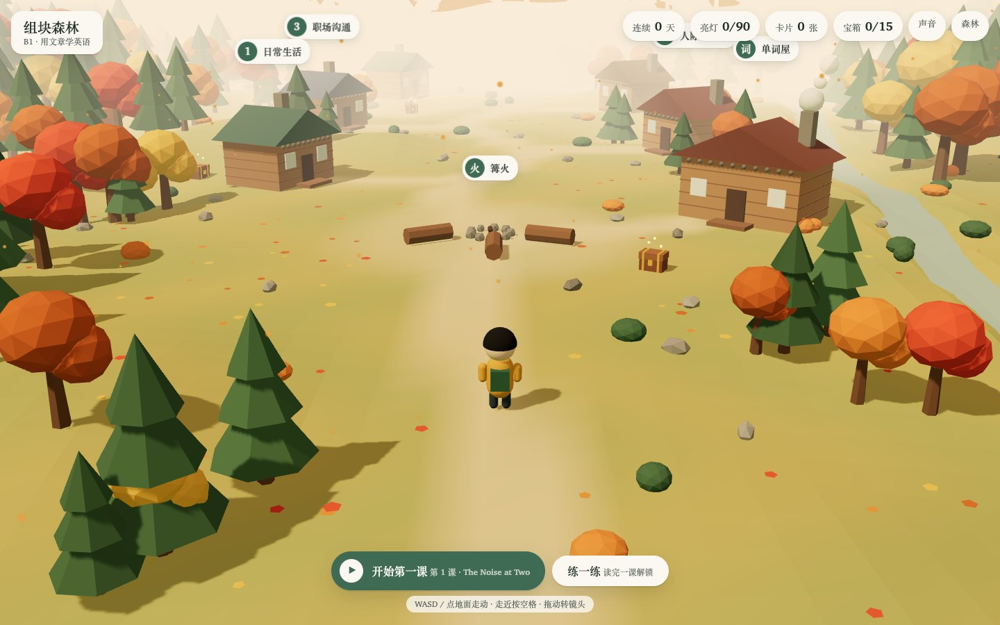

# Chunkwise Forest · 组块森林

**[English](#english) · [中文](#中文)**

**Play it / 在线体验：** https://softminilabs.github.io/chunkwise-forest/

> Best on a computer. It also opens on phones and tablets, but walking around and reading a lesson are less comfortable on a small touch screen.
>
> 建议用电脑打开。手机和平板也能打开，但在小屏幕和触屏上，走动和读课文都没那么顺手。

---

## English

Chunkwise Forest is a small 3D forest you walk through to learn English by reading.
Nine cabins along the trail are the nine B1 units. Read and listen to a lesson, and a lamp lights up under the eaves.
Everything you learn earns water, and the water grows trees and flowers that you plant in the forest.

It runs in the browser. There is no account and nothing to install.

### What is in it

- **90 lessons** in nine units. Each lesson has the text, a recording that highlights the sentence and word being read, three ways to listen (read along, listen blind, shadow), and a set of cards for the chunks worth keeping.
- **A practice fire.** Light the campfire in the clearing and sit down for a round of matching, listening and gap-filling.
- **The Word Lodge.** 6,513 words from A2 to C2 with British and American recordings and example sentences. Learn a few new words a day, review them on a spaced schedule, browse the library, or just listen.
- **The Lecture Hall.** A house with a bell tower west of the campfire clearing holds 66 topics on grammar, word forms and quick-reference tables, each with an explanation and a short quiz.
- **Water and planting.** A finished word is 1 drop, a finished lesson is 3. Water the seed in the pot at the Word Lodge, and when it is grown, choose where it goes in the forest. The map shows everything you have planted.
- **A forest that changes.** Seasons follow the calendar and day and night follow the clock, or you can set them yourself. Weather is clear, rain, snow or a meteor shower.
- **Ambient sound.** Birds, crickets, frogs, wind, rain, the stream and the fire are mixed by season, time of day and weather. Each one can be switched on or off.
- **Chests.** Fifteen chests hidden in the woods open onto the other apps made by the same author.
- **Chinese and English** interface.

### How to play

| | Keyboard and mouse | Touch |
| --- | --- | --- |
| Walk | `W` `A` `S` `D` or the arrow keys, or click the ground | Tap the ground |
| Use something | Walk up to it and press `Space`, or click its tag | Tap its tag |
| Look around | Hold and drag | Hold and drag |
| Zoom | Scroll wheel | |

Progress is kept in your browser (`localStorage`). Clearing site data, or opening the site in another browser, starts again from zero.

### Credits and licenses

- **Word list, definitions, example sentences and their recordings** are adapted from [Word Atlas (词光)](https://github.com/designfuchen/word-atlas) by Word Atlas contributors, licensed under [CC BY 4.0](https://creativecommons.org/licenses/by/4.0/). Changes: entries from A2 to C2 were selected and reformatted for this project, and the illustrations are not included.
- **Ambient sounds** come from the open-source projects [Moodist](https://github.com/remvze/moodist) and [Ambie](https://github.com/jenius-apps/ambie). Each sound keeps the license of its original source.
- **[three.js](https://github.com/mrdoob/three.js)** (0.187.0) and **[qrcode-generator](https://github.com/kazuhikoarase/qrcode-generator)** (2.0.4) are under the MIT License. Copies of both are in `public/vendor/`.
- **Interface icons** are from [Material Symbols](https://fonts.google.com/icons), under the Apache License 2.0.
- **The lessons** (texts, translations, notes and recordings) and **the source code of this project** are © Softminilabs. No open-source license is granted for them at this time.

---

## 中文

组块森林是一片能逛的 3D 小森林，用读文章的方式学英语。
小路两旁的九间木屋是 B1 的九个单元。读完、听完一课，屋檐下就亮一盏灯。
学到的东西会变成水滴，水滴用来养树和花，长成了种进森林里。

在浏览器里直接打开就能玩，不用注册，也不用安装。

### 里面有什么

- **90 课课文**，分九个单元。每一课有原文、朗读（读到哪一句、哪个词，哪里就亮）、三种听法（看着听、盲听、跟读），还有这一课值得记住的组块卡片。
- **篝火练习**。点燃空地中间的篝火，坐下来练一轮：连连看、听一句、填个空。
- **单词屋**。从 A2 到 C2 共 6513 个词，带英音、美音和例句。每天学几个新词，按间隔复习，也可以翻词库，或者只是听。
- **讲堂**。篝火空地西边有一座带钟楼的屋子，里面是 66 个语法、词形表和速查表专题，每个都有讲解和小测。
- **水滴和种树**。学完一个词得 1 滴水，听完一课得 3 滴。在单词屋的花盆里浇种子，长成以后自己挑地方种进森林。森林地图上能看到种下的每一棵。
- **会变的森林**。季节跟着日历走，昼夜跟着时间走，也可以自己改。天气有晴、雨、雪和流星。
- **环境声**。鸟、蟋蟀、蛙、风、雨、溪水、篝火，按季节、昼夜和天气自动搭配，每一种都可以单独开关。
- **宝箱**。林子里藏着 15 只宝箱，打开是作者做的其他 App。
- 界面有**中文和英文**。

### 怎么玩

| | 键盘和鼠标 | 触屏 |
| --- | --- | --- |
| 走动 | `W` `A` `S` `D` 或方向键，也可以点地面 | 点一下地面 |
| 打开东西 | 走到跟前按 `空格`，或者点它头上的牌子 | 点它的牌子 |
| 转镜头 | 按住拖动 | 按住拖动 |
| 拉近拉远 | 滚轮 | |

学习进度存在浏览器里（`localStorage`）。清掉网站数据，或者换一个浏览器打开，就会从头开始。

### 署名和授权

- **词表、释义、例句以及它们的录音**改编自 [词光 Word Atlas](https://github.com/designfuchen/word-atlas)，作者是 Word Atlas contributors，采用 [CC BY 4.0](https://creativecommons.org/licenses/by/4.0/) 授权。改动：挑选了 A2 到 C2 的词条并重新整理成本项目的格式，没有包含插画。
- **环境声**来自开源项目 [Moodist](https://github.com/remvze/moodist) 和 [Ambie](https://github.com/jenius-apps/ambie)，每一条沿用它原始来源的授权。
- **[three.js](https://github.com/mrdoob/three.js)**（0.187.0）和 **[qrcode-generator](https://github.com/kazuhikoarase/qrcode-generator)**（2.0.4）采用 MIT 授权，两者的副本放在 `public/vendor/`。
- **界面图标**来自 [Material Symbols](https://fonts.google.com/icons)，采用 Apache License 2.0。
- **课文**（原文、译文、讲解和朗读）和**本项目的源代码**版权归 Softminilabs 所有，目前没有以开源协议授权。
